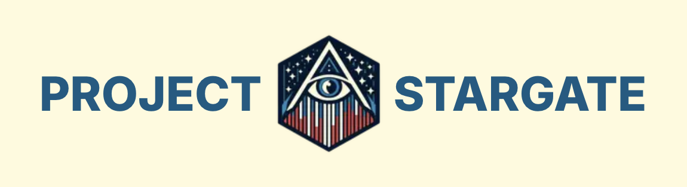
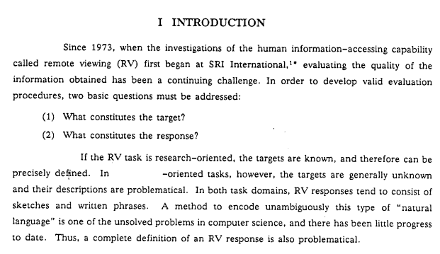
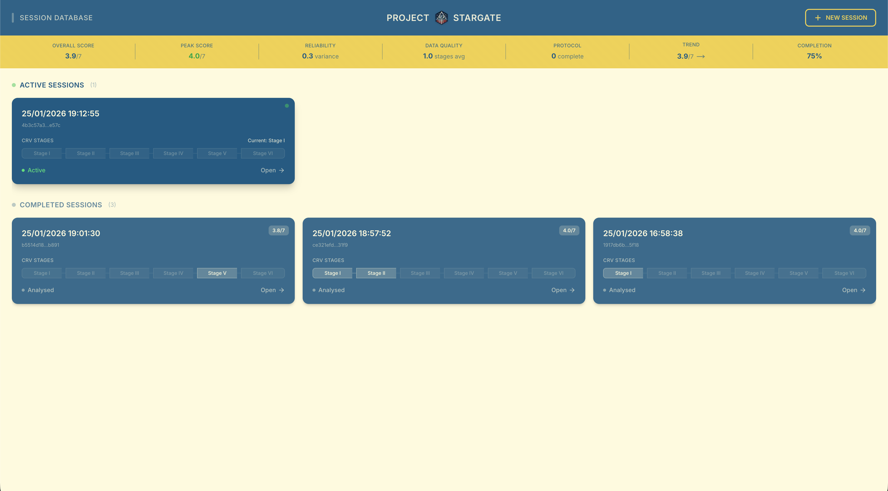
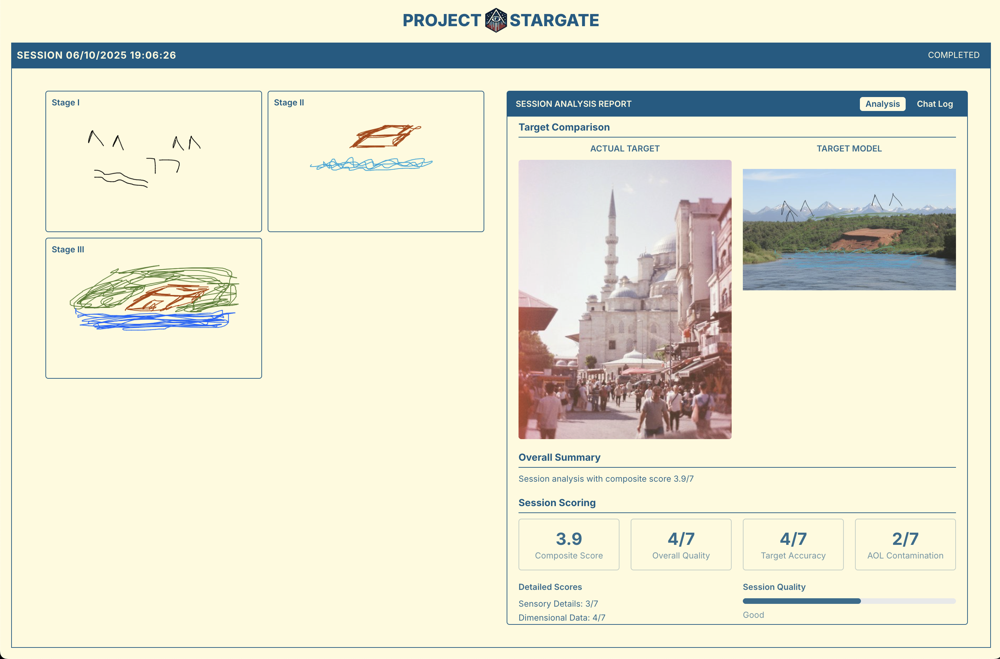

<div align="center">


</div>

<div align="center">
<a style="padding-left: 25px" href="https://idx.google.com/import?url=https%3A%2F%2Fgithub.com%2Fkurtismassey%2Fproject-stargate">
  
</a>
</div>&nbsp;

<div style="padding-top: 25px; padding-bottom: 25px" align="center"></div>&nbsp;

Project Stargate is an open source remote viewing research tool grounded in the [Stanford Research Institute remote viewing record](https://www.newdualism.org/papers/H.Puthoff/CIA-Initiated%20Remote%20Viewing%20At%20Stanford%20Research%20Institute.htm) and the later Star Gate lineage. The live application on `main` is still the freeform chat-and-canvas prototype. The research set below is the target for a protocol-faithful rebuild. Stage gates, sealed tasking, AOL handling, and blind judging are specified there before they land in code.

<div align="center"></div>&nbsp;

Remote viewing returns sketches and natural language, which made automated evaluation hard. Multimodal models such as [Google Gemini](https://cloud.google.com/use-cases/multimodal-ai?hl=en#generate-text-code-video-audio-and-images-from-virtually-any-content-type) make advisory reads of that material practical. Official scores still come from blind rank-order judging, not from the model.

<div align="center"></div>
<div align="center"></div>

## Research documentation

| Document | Contents |
|---|---|
| [`docs/research/SOURCES.md`](docs/research/SOURCES.md) | Primary sources with URLs and what was taken from each |
| [`docs/research/PROGRAM.md`](docs/research/PROGRAM.md) | Program history from SCANATE through STAR GATE |
| [`docs/research/PROTOCOLS.md`](docs/research/PROTOCOLS.md) | CRV stages, AOL, breaks, monitor rules, judging |
| [`docs/research/TART-TTI.md`](docs/research/TART-TTI.md) | Trans-temporal inhibition and schema needs |
| [`docs/research/METRICS.md`](docs/research/METRICS.md) | Fields collected and why |
| [`docs/research/PRODUCT-SPEC.md`](docs/research/PRODUCT-SPEC.md) | Functional and experience requirements |

## Getting started

```bash
make dev
```

Populate `.env` from `example.env` when you want Gemini monitor and analyst paths enabled.
